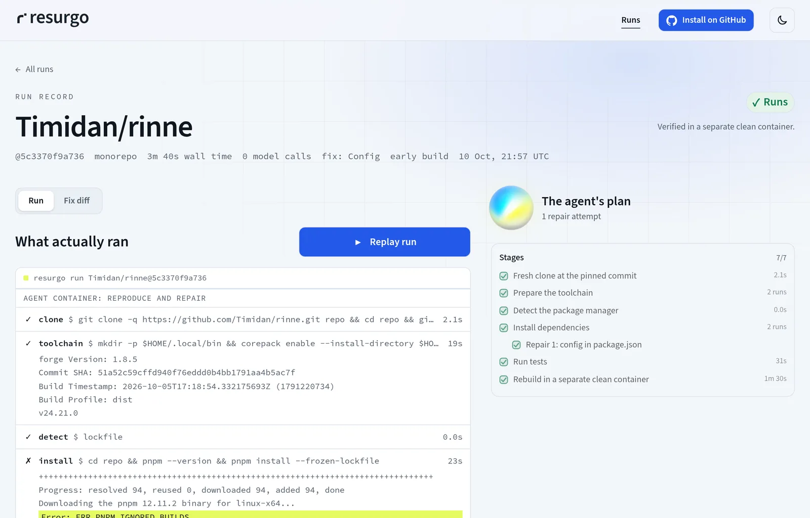
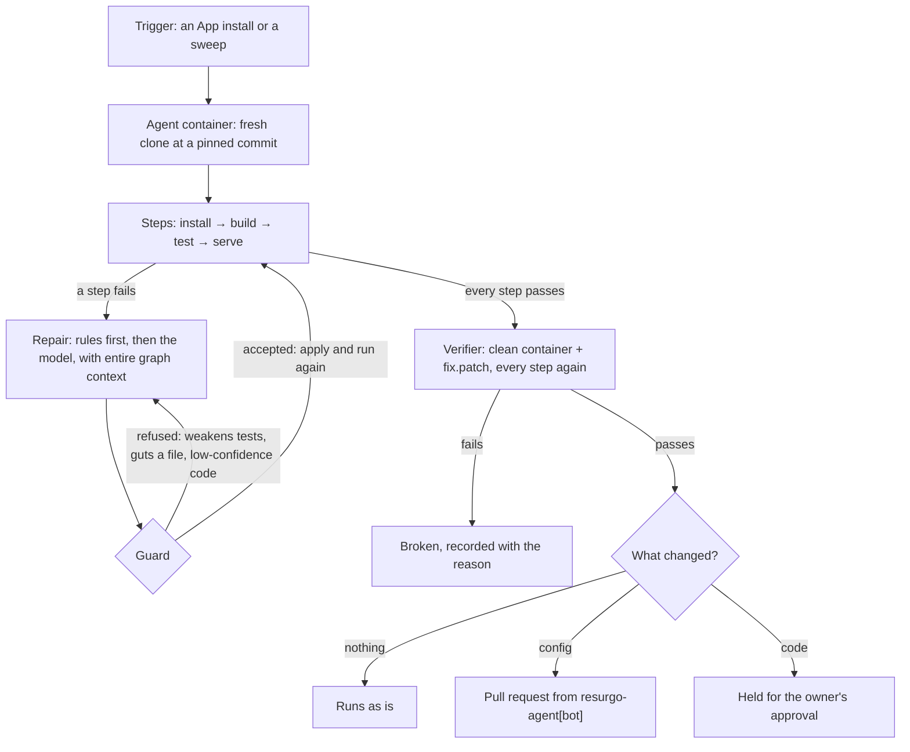
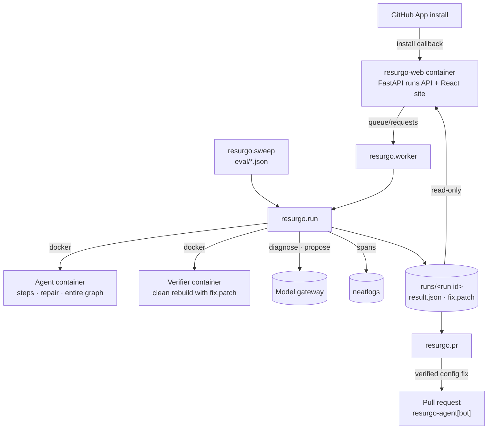
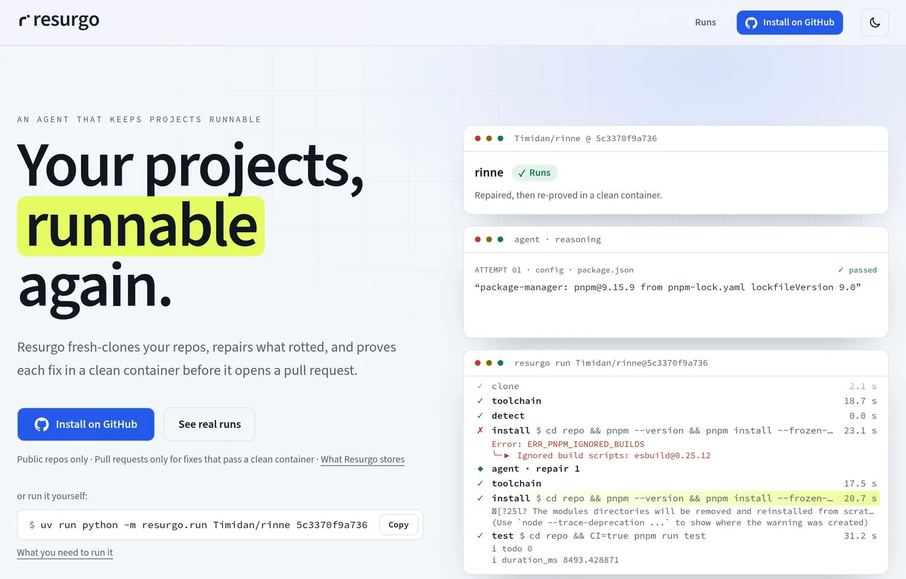

<div align="center">

<picture>
  <source media="(prefers-color-scheme: dark)" srcset="docs/assets/brand/resurgo-mark-inverse.svg">
  
</picture>

# Resurgo

**An agent that keeps your projects runnable.**<br>
It fresh-clones each repository in a throwaway container, repairs what rotted, and opens a pull request only after a separate clean container passes the project's checks.

[Live site](https://resurgo.timidan.xyz) · [Install the GitHub App](https://github.com/apps/resurgo-agent) · [How it works](#how-it-works) · [Evidence](#evidence) · [Quickstart](#quickstart) · [Architecture](#architecture)


</div>

<picture>
  <source media="(prefers-color-scheme: dark)" srcset="docs/assets/run-dark.webp">
  
</picture>

Projects rot while nobody is looking: a lockfile written by a newer package manager, a toolchain that moved on, a test that only passes on an older compiler. Resurgo checks each repository the way a newcomer would: a fresh clone, then install, build, test and start. When a step fails, it tries the least invasive fix first. **Rules** handle the common breakages; then a **model** reads the failure, with the code most related to it from **Entire**'s code graph. Every fix has to pass again in a **second, clean container**. Every step is traced in **neatlogs**.

> [!IMPORTANT]
> Resurgo opens pull requests only for config fixes that passed in a clean container, and only on public repositories where its GitHub App is installed. Code changes are held for the owner's approval. Automatic pull requests are built but switched off (`RESURGO_AUTO_PR`); during neatHack each one was opened by hand after reading the patch.

## Highlights

- **A fresh clone, every time.** Each check starts from a pinned commit in a throwaway container, with no cache from earlier runs.
- **Least invasive fix first.** Rules come before the model: pin the package-manager version that wrote the lockfile, or the Node major a native module needs. The model is asked only when no rule fits.
- **The model sees the right code.** Before diagnosing a build, test or serve failure, the agent runs `entire graph search` inside the container and puts the most related code in the prompt.
- **Guards in code, not in the prompt.** A proposal that skips, excludes or weakens tests, guts a file, or is a code change under 0.5 confidence is refused before it is applied.
- **A second container decides.** The verifier applies the patch to a fresh clone in a clean container and re-runs every step. Only a pass counts.
- **Code waits for you.** Config fixes can become pull requests. Code fixes are held, and the owner's verdict is recorded in `runs/reviews.json`.
- **Everything is a file.** Each run writes `runs/<run id>/result.json` and `fix.patch`, and the site renders those records and nothing else.

## Built with

<table>
  <tr>
    <td align="center" width="170">
      <picture>
        <source media="(prefers-color-scheme: dark)" srcset="docs/assets/logos/neatlogs-white.png">
        
      </picture>
      <br><sub><b>neatlogs</b> · traces, evals, detections</sub>
    </td>
    <td align="center" width="170">
      <picture>
        <source media="(prefers-color-scheme: dark)" srcset="docs/assets/logos/entire-white.svg">
        
      </picture>
      <br><sub><b>Entire</b> · checkpoints, code graph</sub>
    </td>
    <td align="center" width="170">
      <picture>
        <source media="(prefers-color-scheme: dark)" srcset="docs/assets/logos/cfo-white.svg">
        
      </picture>
      <br><sub><b>cfo.ai</b> · business plan</sub>
    </td>
    <td align="center" width="170">
      <picture>
        <source media="(prefers-color-scheme: dark)" srcset="docs/assets/logos/github-white.svg">
        
      </picture>
      <br><sub><b>GitHub App</b> · installs, pull requests</sub>
    </td>
  </tr>
</table>

| Product | What it does in Resurgo |
|---|---|
| **neatlogs** | Traces every run: one workflow span per run, a tool span per step with its command and output, and each model call. An agent-judge evaluator grades runs independently of Resurgo's own verdict. A detection with an in-app alert flags fixes waiting for approval; a second detection is set up to flag proposals the guard refuses. The coding sessions that build Resurgo are traced too, through neatlogs' session hooks. |
| **Entire** | Checkpoints every coding session that built Resurgo. 73 are public and [browsable on entire.io](https://entire.io/gh/Timidan/resurgo/sessions); the rest stay local because they captured private paths. Build-session commits carry an `Entire-Checkpoint` trailer. `entire graph search` gives the repair model repository context. |
| **cfo.ai** | A business plan built with Ari from measured run costs: pricing, unit economics and a 12-month forecast. [Read the plan](https://cfo.ai/s/pDpH9dFTal4PAy76). |

Also used: **LangGraph** (the repair loop), **FastAPI** (the runs API and the site), React 19, Vite, Tailwind CSS v4, Docker, and a model gateway serving gpt-5.6-luna.

## How it works



1. **Trigger.** Installing the GitHub App queues a check of the chosen repositories: public ones, up to 5, with up to 3 project paths each. The worker runs them one at a time and re-checks an installation weekly. Sweeps run the same check over a fixed list (`eval/*.json`).
2. **Run.** In the agent container, Resurgo detects the project type (Node with npm, pnpm, yarn or Bun; Rust; Foundry), prepares the toolchain and runs install, build, test and serve. Each step is a neatlogs tool span with its command and output.
3. **Repair.** When a step fails, rules go first. If none fits, the model diagnoses the failure, with the code regions `entire graph search` ranks highest, and proposes a change. A run gets at most 4 fix attempts.
4. **Guard.** Code checks each proposal before it is applied. A refused proposal is sent back once with the reason.
5. **Verify.** When every step passes, a second, clean container applies `fix.patch` to a fresh clone and re-runs every step.
6. **Ship.** A verified config fix can become a pull request from `resurgo-agent[bot]`. A code fix waits for the owner.

<details>
<summary><b>The guard</b> (<code>resurgo/agent.py</code>, shortened)</summary>

```python
MIN_CODE_CONFIDENCE = 0.5  # a code proposal below this is sent back once
GUT_LINES = 15             # a file may not lose more than this many non-blank lines and half of them

def proposal_problem(box, proposal):
    ...
        elif name == "package.json":
            if test_script(old) != test_script(new):
                weak = weak or f"{f['path']}: changes the test script"
        else:
            if name == "foundry.toml":   # no_match_test, no_match_path, match_test, ...
                added = set(FOUNDRY_FILTER.findall(f["content"])) - set(FOUNDRY_FILTER.findall(
                    box.read(f["path"]) or ""))
                if added:
                    weak = weak or f"{f['path']}: adds or changes test filter {sorted(added)[0][0]}"

def code_problem(box, proposal):
    if proposal["confidence"] < MIN_CODE_CONFIDENCE:
        return "confidence too low for a code change"
    return shrink_problem(box, proposal)   # "this removes most of a file: ..."
```

</details>

<details>
<summary><b>A traced step</b> (<code>resurgo/run.py</code>, shortened)</summary>

```python
with tool_span(f"{self.role}.{name}") as sp:          # agent.install, verifier.test, ...
    rec, out = step(name, self.container, cmd, timeout, self.home, user)
    sp.set_attribute("neatlogs.tool.name", f"{self.role}.{name}")
    sp.set_attribute("input.value", cmd)
    sp.set_attribute("output.value", "\n".join(rec["output_tail"][-TRACE_LINES:]))
    if rec["exit_code"]:
        sp.set_attribute("neatlogs.tool.is_error", True)
        sp.set_status(Status(StatusCode.ERROR, err))   # neatlogs error analysis reads the status
```

</details>

### Run states

Every state is a word and a glyph, on the site and in the records.

| State | Meaning |
|---|---|
| ✓ **Runs** | Every step passed in the clean verifier, with or without a fix. |
| ◐ **Runs with gaps** | Passed, but a step couldn't run in full: no test script, a desktop app that can't start headless, or a secret the check doesn't have. |
| ◆ **Fix verified · awaiting approval** | A code fix passed in the clean container and waits for the owner. |
| ✗ **Broken** | A step still fails after the repair attempts. |
| ✗ **Fix skipped tests · not a repair** | The patch only excluded tests (v1 records; refused since v2.1). |
| ✗ **Fix rejected on review** | The owner rejected the held fix. |
| ◌ **Unsupported** | A project type Resurgo doesn't handle yet. |

## Evidence

| Claim | Evidence |
|---|---|
| The agent improved | rinne, v1 → v2: 31 → 15 spans, 694 s → 374 s, 3 → 0 model calls. neatlogs traces `a1d782454504ecdce5b2b474350cb253` → `489155f78e1266be4d73a6fc525bce79`. The v1 traces showed pnpm repos failing the same way, so v2 added the lockfile rule. [Details](docs/evidence/neatlogs/README.md). |
| It recovers when an action fails | rinne under v1 (`runs/20261010T101804Z-5c3370f`): the model's first two fixes failed at install, the third passed, and the clean verifier confirmed it. |
| An honest baseline | v1 on 24 held-out repositories: 13 passed the verifier, 2 of them only by skipping tests, and 1 was a genuine fix (xsv's toolchain pin). v2.1's guard refuses test skips. |
| An independent judge | neatlogs' agent judge over 23 v1 held-out traces agrees with the run records on 22. It passed vulcan's test skip, which the code guard refuses. |
| A real pull request | [Timidan/rinne#1](https://github.com/Timidan/rinne/pull/1), opened by `resurgo-agent[bot]`: one `packageManager` line, verified before it was opened. |
| An Entire checkpoint | [`01M4MYQFSKXF617DT4JF4GXY0V`](https://entire.io/gh/Timidan/resurgo/commit/de9f945b86a2747d4795501bd33041aa6b906808), on the commit that added the guard against gutted files and low-confidence code, with [the session that wrote it](https://entire.io/gh/Timidan/resurgo/session/e29c25fe-91e1-4850-a3dd-c71d327fc3e2). Every published build session is on [entire.io](https://entire.io/gh/Timidan/resurgo/sessions), and Entire's [build dispatch](docs/evidence/entire/dispatch-2026-10-11.md) summarises them. |
| A business case | [cfo.ai plan](https://cfo.ai/s/pDpH9dFTal4PAy76): $0.0112 per check, $12 a month for 10 repositories, break-even at 3 paying accounts on one $7 server. [Summary](docs/evidence/cfo/README.md). |

The build log, decision by decision, is [hackathon.md](hackathon.md).

## Architecture



- **Containers do the work.** Each check starts an agent and a verifier container on a Docker host, labelled with the run ID and removed when the run ends. Each gets 2 CPUs, 6 GB of memory and 512 processes, with every capability dropped and `no-new-privileges`.
- **The site only reads.** The web container mounts the run records read-only and the install queue read-write. It publishes no ports and sits behind a reverse proxy.
- **Addresses stay out of the records.** Output is scrubbed of the Docker host and model gateway addresses before it is written or traced.
- **Pull requests have preconditions.** `resurgo/pr.py` refuses a run whose verifier did not pass, an empty patch, a moved head, an existing pull request, a fix that needs approval, or one rejected on review. Its GitHub token is scoped to the one repository, with contents and pull-request write access, and reaches git through a credential helper, never a URL.

## Quickstart

**Requirements:** Python 3.12+, [uv](https://docs.astral.sh/uv/), a Docker host, a model gateway, and Node.js 22 for the site.

```sh
# 1. Check one repository. The record lands in runs/<run id>/
uv sync
uv run python -m resurgo.run Timidan/rinne 5c3370f9a736

# 2. The site: the API on :8787 serves the run records and web/dist
(cd web && npm ci && npm run build)
RUNS_DIR=runs uv run uvicorn api.main:app --port 8787

# 3. Optional: Vite with hot reload on :5173, proxying /api to :8787
(cd web && npm run dev)
```

<details>
<summary><b>Optional: run a sweep</b></summary>

```sh
uv run python -m resurgo.sweep eval/dev.json --agent-version dev
uv run python -m resurgo.sweep eval/heldout.json --agent-version v2 --sweep-id v2-heldout   # resumes if interrupted
```

</details>

<details>
<summary><b>Optional: the GitHub App worker</b></summary>

```sh
QUEUE_DIR=/path/to/queue uv run python -m resurgo.worker          # runs until stopped
uv run python -m resurgo.pr runs/<run id> --dry-run               # what a pull request would contain
```

</details>

## Configuration

Variables can sit in a `.env` file in the repository root.

| Variable | Purpose |
|---|---|
| `DOCKER_HOST` | The Docker daemon that runs the containers, if it isn't local. Scrubbed from all output. |
| `MODEL_GATEWAY_URL` | The repair model's gateway: `POST /v1/completions` with `{system, user}`, returning `{text}`. Scrubbed from all output. |
| `NEATLOGS_API_KEY` | Optional. Traces each run to neatlogs. Without it the run still works and prints a warning. |
| `RESURGO_ENTIRE_BIN` | Optional. Path on the Docker host to the `entire` binary, mounted read-only into the agent container. Empty skips the mount. |
| `RESURGO_ENTIRE_GRAPH_BIN` | Optional. The entire-graph plugin on the machine running Resurgo, copied into the agent container on first use. |
| `RESURGO_END_USER` · `RESURGO_END_USER_SOURCE` | Optional. The neatlogs end user for a run. The worker sets the installation's account; sweeps set the repository owner. |
| `GITHUB_APP_CLIENT_ID` · `GITHUB_APP_PRIVATE_KEY` | The GitHub App's client ID and the path to its private key, for the worker and `resurgo.pr`. |
| `RESURGO_AUTO_PR` | `1` lets the worker open pull requests for verified config fixes. Off by default. |
| `QUEUE_DIR` | The install queue: the API writes `requests/`, the worker writes `status/`. |
| `RUNS_DIR` · `WEB_DIST` · `SITE_URL` | The API's run records, built site and public URL. |

> [!CAUTION]
> Resurgo runs each repository's own install, build and test scripts. Use a Docker host you're willing to run untrusted code on: the containers are limited, but they share the host's kernel. Never commit `.env` or the App's private key.

## API

The API serves the live site at [resurgo.timidan.xyz](https://resurgo.timidan.xyz). Every route is public and read-only, except the install callback.

| Route | Returns |
|---|---|
| `GET /api/runs` | A summary of every run record: repository, state, fix kind, steps, model calls |
| `GET /api/runs/{run_id}` | One run: every step with its output, each attempt, the patch, the verifier and the review |
| `GET /api/installations/{id}` | Progress of an install's checks |
| `GET /auth/github/callback` | The GitHub App's setup callback; queues the installation |
| `GET /index.md` · `GET /llms.txt` | The site as text, for agents |

```sh
curl -s https://resurgo.timidan.xyz/api/runs | jq '.[] | {repo, status, fix_kind, verified}' | head -24
```

## Commands

| Command | |
|---|---|
| `uv run python -m resurgo.run <owner/repo> <sha> [--path <dir>]` | Check one repository |
| `uv run python -m resurgo.sweep <eval/*.json> --agent-version <v>` | Check a list, resumable with `--sweep-id` |
| `uv run python -m resurgo.worker [--once]` | Work through GitHub App installs |
| `uv run python -m resurgo.pr <run dir> [--dry-run]` | Open the pull request for a verified config fix |
| `uv run --with pytest pytest -q resurgo api` | Tests |
| `cd web && npm run build` | Type-check and build the site |
| `node web/check-render.mjs` | Render check: no blank pages, no sideways scroll, logos drawn |

## Project structure

```text
resurgo/
├── resurgo/
│   ├── run.py         One check: containers, steps, tracing, the verifier, the run record
│   ├── agent.py       The LangGraph repair loop: diagnose, propose, guard, apply
│   ├── rules.py       Deterministic fixes tried before the model
│   ├── project.py     Project-type detection and toolchains
│   ├── gateway.py     Model gateway client
│   ├── sweep.py       Runs a list of repositories
│   ├── worker.py      The GitHub App install queue
│   ├── pr.py          Pull requests from resurgo-agent[bot]
│   └── probe.js       Serve check: waits for a port, then requests /
├── api/main.py        Runs API, install callback and the built site
├── web/               React 19, Vite and Tailwind CSS v4
├── eval/              dev.json and heldout.json, the repository sets
├── deploy/            Docker Compose for the site
└── docs/              Plan, landing and animation notes, evidence
```

Run records are written to `runs/`, which git ignores.

## Deploy

The site and API run as one container. The worker and sweeps run on the host with uv.

```sh
RESURGO_RUNS_DIR=/path/to/runs RESURGO_QUEUE_DIR=/path/to/queue \
  docker compose -f deploy/compose.yaml -p resurgo-web up -d --build
```

- **No published ports.** The container joins the `public_proxy` network behind an existing reverse proxy.
- **One user for the queue.** It runs as uid 1000, the host account that owns the queue, so the worker can read and remove the requests the API writes.

## Testing

```sh
uv run --with pytest pytest -q resurgo api
cd web && npm run build && node check-render.mjs   # needs the API on :8787 and chromium
```

The Python tests run offline: no Docker, model or keys.

## Design

- [docs/LANDING.md](docs/LANDING.md): the site's structure and copy.
- [docs/ANIMATION.md](docs/ANIMATION.md): motion, after Lasseter's principles.
- [web/public/brand/README.md](web/public/brand/README.md): the mark, palette and type.

<picture>
  <source media="(prefers-color-scheme: dark)" srcset="docs/assets/landing-dark.webp">
  
</picture>
