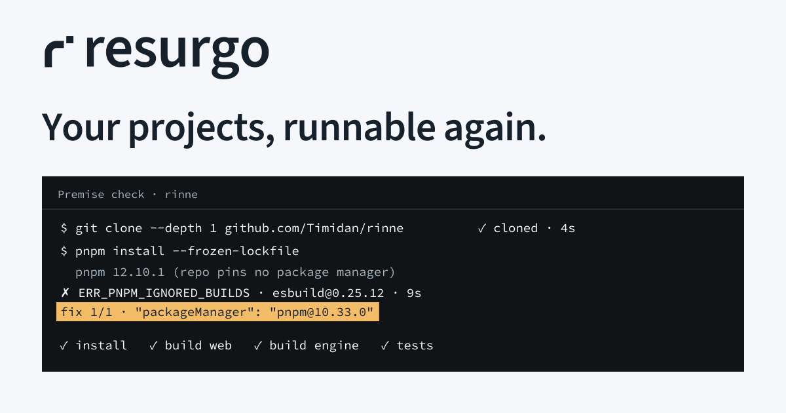
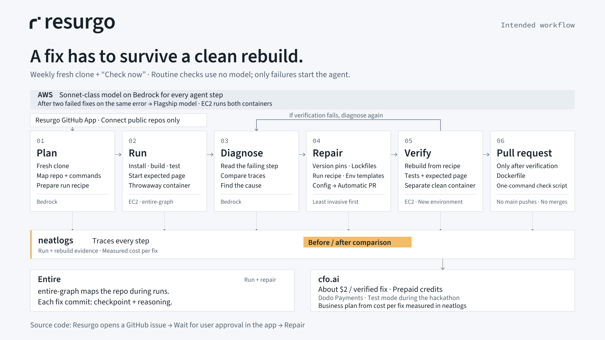

# Resurgo

Pronounced **reh-SUR-go**; Latin for “I rise again”.

Renamed from **Rouse** on **9 Oct 2026**. [concept-a.svg](concept-a.svg), [concept-b.svg](concept-b.svg), [concept-c.svg](concept-c.svg), and [BRIEF.md](BRIEF.md) are preserved as historical files and retain the original name.

Your projects, runnable again.



## Concepts

| Concept | One-line rationale |
| --- | --- |
| [A · Lifted r](concept-a.svg) — chosen | A lowercase r with a raised terminal block brings a dormant repo back up. |
| [B · Return loop](concept-b.svg) | A folded return arrow makes the diagnose, repair and rerun cycle the mark. |
| [C · Witness frames](concept-c.svg) | Two facing frames represent a run checked by a separate clean environment. |

The lifted r gives Resurgo a recognisable initial and turns “wake the repo” into one small, concrete movement. Its thick strokes and separated square remain clear at 16px, and its single-colour form fits a quiet tool built around terminal evidence.

## Palette

Cool neutral surfaces, ink text, and one amber highlighter for fixes and evidence. The accent is a background fill with dark text; it does not indicate a run state by itself.

| Role | Light | Dark |
| --- | --- | --- |
| Canvas | `#F5F7FA` | `#101417` |
| Panel | `#FFFFFF` | `#191F25` |
| Subtle surface | `#E8EDF2` | `#191F25` |
| Primary text / logo | `#17212B` | `#F5F7FA` |
| Secondary text | `#526171` | `#A8B3BD` |
| Decorative hairline | `#CBD2DA` | `#35414C` |
| Evidence / fix highlight | `#F3BC66` | `#F3BC66` |
| Text on highlight | `#17212B` | `#17212B` |

All approved text pairs exceed WCAG AA's 4.5:1 normal-text threshold. Primary text on canvas is **15.18:1 light / 17.25:1 dark**; secondary text on canvas is **5.92:1 light / 8.68:1 dark**; ink on amber is **9.46:1**. Secondary text on panels is **6.35:1 light / 7.79:1 dark**. Hairlines are decorative: use the secondary-text colour for meaningful glyphs and arrows, and primary text for control boundaries or focus indicators that need contrast. Do not use amber as text on white or white text on amber.

States always retain a word and a glyph: `✓ Runs`, `◐ Runs with gaps`, `✗ Broken`, `◌ Checking`. Use neutral text for these states; reserve amber for the supporting evidence or fix. The specified in-place action progresses from “Check” through real step labels to its final state. These assets define visual usage; they do not implement the button or the app.

## Type and logo usage

- **Wordmark:** lowercase Source Sans 3 Semibold, outlined into paths, with slightly tightened spacing and a closer gap between the mark and “resurgo”. The lifted r mark is original vector geometry.
- **Headings and UI:** Source Sans 3 Semibold; body labels use Source Sans 3 Regular.
- **Terminal and timings:** Source Code Pro Regular; the supplied `✗` uses an outlined DejaVu Sans glyph.
- All SVG lettering, including diagram labels, is paths. There are no external font references, embedded raster images, gradients, filters, shadows or network resources. No fonts need to be installed to display the finished assets.
- `logo-wordmark-light.svg` means **for a light background**; `logo-wordmark-dark.svg` means **for a dark background**. Both are transparent. The favicon and Apple icon use an opaque dark tile.
- `logo-mark.svg` uses `currentColor`: inline its SVG and set CSS `color` on its parent. An SVG loaded through an `` does not inherit the page's colour; use the fixed-colour wordmarks or set a colour inside that SVG when needed.
- The mark's native grid is 16 × 16; minimum display size is 16px. Keep the wordmark at least 128px wide, preserve its aspect ratio, and leave clear space of at least one raised-square width around the artwork. Do not add effects or recolour the raised square separately.

## Architecture and evidence



Users connect repositories through the **Resurgo GitHub App**, with public repositories only for now. Resurgo runs a weekly fresh-clone check and offers **Check now**. Routine checks use no model; a failure activates the agent.

The agent follows plan → run in a throwaway container → diagnose → repair, least invasive first → verify in a separate clean container → pull request. Every model-assisted step uses a **Sonnet-class model on AWS Bedrock**; after **two failed fixes on the same error**, Resurgo escalates to a flagship model. EC2 hosts the run and verification containers. Failed verification returns to diagnosis.

Config fixes—version pins, lockfiles, the run recipe and environment templates—go automatically into a pull request after independent verification, without an approval gate. Source-code changes wait for the user's approval in the Resurgo app; Resurgo opens a GitHub issue to ask before making those changes. Resurgo never pushes to main and never merges. Each pull request includes the **Dockerfile and a one-command check script** so anyone can reproduce the proof.

neatlogs traces every step, supports before/after comparison and measures cost per fix. Entire supplies the entire-graph repo map during runs and a checkpoint on each fix commit, which also carries the reasoning. Builders pay **about $2 per verified fix** through prepaid credits via **Dodo Payments**, using **test mode during the hackathon**. cfo.ai models the business plan from the cost per fix measured in neatlogs. The price is a planned charge, not a measured cost or revenue claim; the diagram remains labelled **“Intended workflow.”**

The OG card reproduces only the six terminal lines supplied in [BRIEF.md](BRIEF.md), including the failed install and package-manager fix. That record establishes the supplied premise-check output; it does not establish a separate clean-container verification or a working sponsor integration. No costs, performance numbers, live integration status or additional terminal output have been invented.

The video title reads “Wake the repo. Prove it runs.” The end card reads “A clean rebuild is the proof.” Both are static 1920 × 1080 cards, with vector sources included for resizing.

## Files

All 16 requested files are present. The two additional SVGs are the vector sources for the requested video PNGs.

| File | Purpose / dimensions |
| --- | --- |
| [concept-a.svg](concept-a.svg) | Lifted r exploration; 800 × 480, including 16px and 32px samples |
| [concept-b.svg](concept-b.svg) | Return loop exploration; 800 × 480 |
| [concept-c.svg](concept-c.svg) | Witness frames exploration; 800 × 480 |
| [logo-mark.svg](logo-mark.svg) | Transparent `currentColor` mark; 16 × 16 |
| [logo-wordmark-light.svg](logo-wordmark-light.svg) | Ink mark + outlined lowercase wordmark; 480 × 112 |
| [logo-wordmark-dark.svg](logo-wordmark-dark.svg) | Light mark + outlined lowercase wordmark; 480 × 112 |
| [favicon.svg](favicon.svg) | Dark tile with light mark; 16 × 16 |
| [favicon-32.png](favicon-32.png) | 32 × 32 favicon |
| [apple-touch-icon.png](apple-touch-icon.png) | 180 × 180 Apple touch icon |
| [og-card.svg](og-card.svg) | Vector social card; 1200 × 630 |
| [og-card.png](og-card.png) | Social card; 1200 × 630 |
| [architecture.svg](architecture.svg) | Vector workflow diagram; 1920 × 1080 |
| [architecture.png](architecture.png) | Workflow diagram; 1920 × 1080 |
| [video-title.png](video-title.png) | Opening video card; 1920 × 1080 |
| [video-end.png](video-end.png) | Closing video card; 1920 × 1080 |
| [README.md](README.md) | Concepts, palette, type, usage and file list |
| [video-title.svg](video-title.svg) | Additional vector source for the opening card; 1920 × 1080 |
| [video-end.svg](video-end.svg) | Additional vector source for the closing card; 1920 × 1080 |

## Rendering and checks

All PNGs were rendered locally with `rsvg-convert`, checked for exact dimensions, and opened for visual inspection. The concepts and light/dark logo use were also inspected, including the mark at native 16px. Text contrast was calculated from the hex values; every SVG was parsed and checked for path lettering and absence of external resources.

To regenerate the six PNGs from the SVG sources, run these commands from this folder:

```sh
rsvg-convert -w 32 -h 32 favicon.svg -o favicon-32.png
rsvg-convert -w 180 -h 180 favicon.svg -o apple-touch-icon.png
rsvg-convert og-card.svg -o og-card.png
rsvg-convert architecture.svg -o architecture.png
rsvg-convert video-title.svg -o video-title.png
rsvg-convert video-end.svg -o video-end.png
```

No requested deliverables were omitted. No network calls, sign-ups, posts or app changes were made. Live integrations and platform upload previews were not checked; the architecture is explicitly labelled “Intended workflow.”
